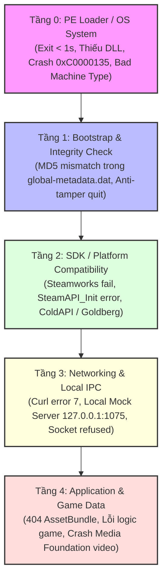

# Cẩm Nang Kỹ Thuật & Hướng Dẫn Phát Triển (Master Contributor & Architecture Guide)

> **Dự án:** Steamdeck VHGame Installer (`steamdeck-vhgame-installer`) — Framework Chạy Game Windows & Mod Việt Hóa trên Linux / Steam Deck  
> **Dành cho:** Nhà phát triển, Kỹ sư Reverse Engineering, Modder, Contributor và AI Coding Agents muốn **Fork**, tối ưu hoặc phát triển các công cụ vá lỗi game trên Linux / SteamOS.

---

## 📑 Mục Lục

1. [Triết Lý & Nguyên Tắc "Đo Trước, Sửa Sau"](#1-triết-lý--nguyên-tắc-đo-trước-sửa-sau)
2. [Kiến Trúc Chẩn Đoán 5 Tầng (5-Layer Diagnostic Model)](#2-kiến-trúc-chẩn-đoán-5-tầng-5-layer-diagnostic-model)
3. [Kiến Trúc Mod Việt Hóa & Bẫy Tương Thích Wine-Mono](#3-kiến-trúc-mod-việt-hóa--bẫy-tương-thích-wine-mono)
4. [Bộ Công Cụ Dịch Ngược & Vá Nhị Phân (`tools/`)](#4-bộ-công-cụ-dịch-ngược--vá-nhị-phân-tools)
5. [Bản Đồ Kết Nối Tài Liệu Dự Án](#5-bản-đồ-kết-nối-tài-liệu-dự-án)
6. [Lộ Trình Mở Kêu Gọi Cộng Đồng Fork & Phát Triển (Roadmap)](#6-lộ-trình-mở-kêu-gọi-cộng-đồng-fork--phát-triển-roadmap)

---

## 1. Triết Lý & Nguyên Tắc "Đo Trước, Sửa Sau"

Dự án này được xây dựng trên nguyên tắc khoa học kỹ thuật nghiêm ngặt: **Không suy đoán. Mọi can thiệp nhị phân đều phải có số liệu đo lường thực tế.**

### Quy ước nhãn bằng chứng:
- `[ĐO]`: Đã chạy lệnh trực tiếp trên môi trường và trích xuất log/offset — mức độ tin cậy 100%.
- `[SUY]`: Suy luận logic từ dữ liệu đã đo, nhưng chưa kiểm chứng thực nghiệm độc lập.
- `[CHƯA RÕ]`: Hiện tượng quan sát được nhưng chưa xác định được nguyên nhân tầng dưới — nghiêm cấm khẳng định bừa bãi.

### 5 Quy tắc vàng khi vá game nhị phân:
1. **Log quyết định, không phải cảm giác:** Luôn kích hoạt `WINEDEBUG` hoặc kiểm tra `Player.log` của Unity trước khi sửa.
2. **Sửa 1 biến số tại một thời điểm:** Nếu đổi cả Proton lẫn vá file DLL cùng lúc, bạn sẽ không bao giờ biết nguyên nhân thực sự là gì.
3. **Luôn sao lưu (Backup) trước khi ghi đè:** Đặt tên rõ ràng (ví dụ: `.bak_patch`), kiểm tra mã hash MD5 trước và sau.
4. **Vá nhị phân In-place (Bảo toàn byte length):** Khi thay đổi chuỗi string literal hay hằng số trong file PE/Metadata, độ dài chuỗi thay thế phải **bằng đúng 100%** chuỗi ban đầu để không làm xô lệch con trỏ (offset pointer) và bảng địa chỉ ảo.
5. **Không làm ô nhiễm `System32` của Wine Prefix:** Mọi thư viện hook / wrapper phải được đặt theo cơ chế Side-by-Side (cùng thư mục với file `.exe` gọi nó).

---

## 2. Kiến Trúc Chẩn Đoán 5 Tầng (5-Layer Diagnostic Model)

Mọi lỗi khi chạy một game Windows trên Linux (Proton/Wine/Steam Deck) đều thuộc về 1 trong 5 tầng độc lập sau:



| Tầng | Triệu chứng điển hình | Công cụ xác định | Cách xử lý mẫu |
|---|---|---|---|
| **Tầng 0: PE Loader** | Tiến trình tắt ngúm trong <1s, mã lỗi `0xC0000135` | `python-pefile`, `tools/dump_minidump.py` | Bổ sung DLL runtime, kiểm tra kiến trúc x86 vs x64, CRT `/MD` vs `/MDd` |
| **Tầng 1: Integrity** | Cửa sổ game chớp lên rồi tắt, log có `md5 != _SteamApiMd5` | `tools/find_md5_literals.py`, `tools/patch_md5.py` | Tìm hằng MD5 hardcode trong `global-metadata.dat` và vá in-place |
| **Tầng 2: SDK Layer** | "Steamworks is not initialized", kẹt màn hình chờ | Kiểm tra `steam_api64.dll`, file `steam_interfaces.txt` | Cấu hình Steam AppID, dùng emulator tương thích (Goldberg/ColdAPI) |
| **Tầng 3: Networking** | "Curl error 7: Failed to connect", vòng lặp thử lại mạng | `ss -tulpn`, `curl http://127.0.0.1:port` | Dựng mock server nội bộ (Python/Node) đón request kiểm tra token |
| **Tầng 4: Application** | Màn hình sọc màu SMPTE (thiếu video codec), văng game | Kiểm tra GStreamer / Proton-GE, kiểm tra font | Đổi sang GE-Proton (hỗ trợ Media Foundation WMV/MP4), chèn font fallback |

---

## 3. Kiến Trúc Mod Việt Hóa & Bẫy Tương Thích Wine-Mono

Các bản mod Việt Hóa game (đặc biệt từ các nhóm dịch thuật tại Việt Nam như HBHGAME, TheRedTeam, GameTiengViet...) thường sử dụng kỹ thuật DLL Hijacking kết hợp tiêm nạp mã quản lý (Managed CLR Injection):

```text
[Game.exe] 
    └── Nạp DLL mạo danh (version.dll / ddraw.dll / winmm.dll)
            └── Native C++ Hook khởi động Mono / .NET CLR
                    └── Tải file Mod Assembly (.dll)
                            └── Nạp Text & Override Font
```

### Bẫy lỗi kinh điển: Wine-Mono `strrchr` Crash (Mã lỗi `0x80070057` / Crash `0x0`)
- **Nguyên nhân:** Trên Windows, .NET Framework CLR chấp nhận các lớp (class) nằm trực tiếp ở **Global Namespace** (không có `namespace MyMod { ... }`). Nhưng trên Linux, triển khai mã nguồn mở `Wine-Mono` khi gọi hàm `mono_assembly_load_from` duyệt chuỗi qua hàm `strrchr(class_name, '.')`. Khi class không có dấu chấm phân cách namespace, con trỏ trả về `NULL`, gây dereference sập tiến trình ngay tại entry point (`Exit Code 5`).
- **Bản vá trong [`patch_hbhgame_mod.py`](tools/patch_hbhgame_mod.py):** Sử dụng thuật toán quét PE Metadata của file .NET, tìm namespace rỗng và tiêm chuỗi định danh namespace hợp lệ để Wine-Mono không bị crash.

---

## 4. Bộ Công Cụ Dịch Ngược & Vá Nhị Phân (`tools/`)

Các script nằm trong thư mục [`tools/`](tools/) được viết bằng Python thuần túy, có thể chạy trên mọi máy Linux và Steam Deck:

### 1. `find_md5_literals.py`
- **Mục đích:** Tự động dò cấu trúc bảng `stringLiteral` và `stringLiteralData` trong file `global-metadata.dat` (Unity IL2CPP).
- **Điểm đặc biệt:** Không hardcode offset cố định mà tự động phân tích thử tự trường (`length_first` vs `dataIndex_first`), hỗ trợ chính xác Unity IL2CPP từ metadata version 29 đến 31.
- **Sử dụng:**
  ```bash
  python3 tools/find_md5_literals.py "path/to/global-metadata.dat"
  ```

### 2. `patch_md5.py`
- **Mục đích:** Thay thế hằng số MD5 32 ký tự hex trong file nhị phân.
- **Tính năng an toàn:** Bắt buộc `--dry-run` trước khi ghi; tự động tạo bản sao lưu `.bak_patch`; bảo toàn 100% cấu trúc offset của file.
- **Sử dụng:**
  ```bash
  python3 tools/patch_md5.py "path/to/file" <OLD_MD5_32_HEX> <NEW_MD5_32_HEX> --dry-run
  python3 tools/patch_md5.py "path/to/file" <OLD_MD5_32_HEX> <NEW_MD5_32_HEX>
  ```

### 3. `patch_hbhgame_mod.py`
- **Mục đích:** Khắc phục lỗi crash do Wine-Mono không xử lý được Global Namespace trong các bản mod Việt Hóa.
- **Sử dụng:**
  ```bash
  python3 tools/patch_hbhgame_mod.py "path/to/Mod.dll"
  ```

### 4. `dump_minidump.py`
- **Mục đích:** Đọc và phân tích trực tiếp file `crash.dmp` do Wine tạo ra mà không cần cài đặt Windows Debugger hay `gdb` phức tạp.
- **Trích xuất:** Exception Code, Địa chỉ lệnh gây crash (`RIP`), Con trỏ ngăn xếp (`RSP`) và 16 Stack Frames đỉnh.

---

## 5. Bản Đồ Kết Nối Tài Liệu Dự Án

| Tệp tin | Vai trò & Trọng tâm | Khi nào cần đọc? |
|---|---|---|
| [`README.md`](README.md) | Tổng quan dự án, bảng so sánh, hướng dẫn cài đặt nhanh | Khi mới tiếp cận dự án |
| [`GUIDE.md`](GUIDE.md) *(Tài liệu này)* | Kiến trúc tổng thể, mô hình 5 tầng, phân tích dịch ngược | Dành cho Contributor & AI Agent muốn hiểu bản chất |
| [`WALKTHROUGH.md`](WALKTHROUGH.md) | Quy trình thực hành từng bước từ lúc giải nén game đến khi chơi | Khi cần cài đặt một tựa game mới |
| [`PLAYBOOK.md`](PLAYBOOK.md) | Sổ tay chẩn đoán chi tiết 5 Case study lỗi game phức tạp | Khi game bị crash hoặc không lên hình |
| [`VIETHOA_MOD_PLAYBOOK.md`](VIETHOA_MOD_PLAYBOOK.md) | Sổ tay chuyên sâu về các lỗi Mod Việt Hóa (Hook, CLR, Media Foundation) | Khi game gốc chạy được nhưng cài mod Việt Hóa thì crash |
| [`VIETHOA_FRAMEWORK_GUIDE.md`](VIETHOA_FRAMEWORK_GUIDE.md) | Cẩm nang thiết kế và xây dựng bộ mod Việt Hóa từ đầu cho Unity & Unreal | Dành cho dịch giả và lập trình viên làm mod game |
| [`CHANGELOG.md`](CHANGELOG.md) | Nhật ký các can thiệp nhị phân đã thử nghiệm và cách hoàn nguyên | Tra cứu đối chiếu thay đổi |
| [`tools/README.md`](tools/README.md) | Hướng dẫn chi tiết cách dùng từng script trong `tools/` | Khi cần chạy script vá nhị phân |

---

## 6. Lộ Trình Mở Kêu Gọi Cộng Đồng Fork & Phát Triển (Roadmap)

Chúng tôi kêu gọi cộng đồng Linux, Steam Deck và các Modder cùng **Fork** dự án để phát triển các tính năng tiếp theo:

### 🚀 1. Hợp nhất thành CLI Tool tự động (`game-fix-cli`)
- Viết một công cụ dòng lệnh (bằng Python hoặc Rust):
  - Tự động quét thư mục game để nhận diện engine (Unity Mono, Unity IL2CPP, Unreal Engine, Godot, RPG Maker).
  - Tự động chạy chẩn đoán 5 tầng và đưa ra gợi ý cờ Proton phù hợp.
  - Tự động phát hiện và vá lỗi Wine-Mono Global Namespace chỉ với 1 lệnh: `game-fix patch-mod <dir>`.

### 🎮 2. Plugin Decky Loader cho Steam Deck
- Đóng gói logic chẩn đoán thành một plugin trên **Decky Loader** (SteamOS).
- Cho phép người dùng Steam Deck chỉ cần bấm nút ba chấm `...` trên máy, chọn "Fix Game / Mod Việt Hóa" và tự động áp dụng bản vá mà không cần chuyển sang Desktop Mode.

### 🧩 3. Mở rộng bộ phân tích Unity IL2CPP Metadata v32+
- Nâng cấp `find_md5_literals.py` để tương thích hoàn toàn với Unity 2023+ và Unity 6 (metadata version 32 và 33).

### 🌐 4. Kho Tri Thức Tương Thích Game & Mod (Community Compatibility Database)
- Xây dựng kho dữ liệu các tựa game đã kiểm chứng, bao gồm cấu hình Proton tối ưu, AppID, các chuỗi MD5 cần patch và đường dẫn tải font chữ tương thích.

---

## 🤝 Cách Tham Gia Đóng Góp

1. **Fork** repository này về tài khoản GitHub của bạn.
2. Tạo nhánh mới (`git checkout -b feature/tinh-nang-moi`).
3. Thực hiện kiểm thử trên môi trường thực tế (luôn tuân thủ nguyên tắc `[ĐO]` trước khi viết).
4. Gửi **Pull Request (PR)** để cùng thảo luận và hợp nhất mã nguồn.

*Mỗi dòng code và bản vá của bạn sẽ giúp cộng đồng game thủ Linux & Steam Deck tiếp cận dễ dàng hơn với hàng ngàn tựa game tuyệt vời!*
